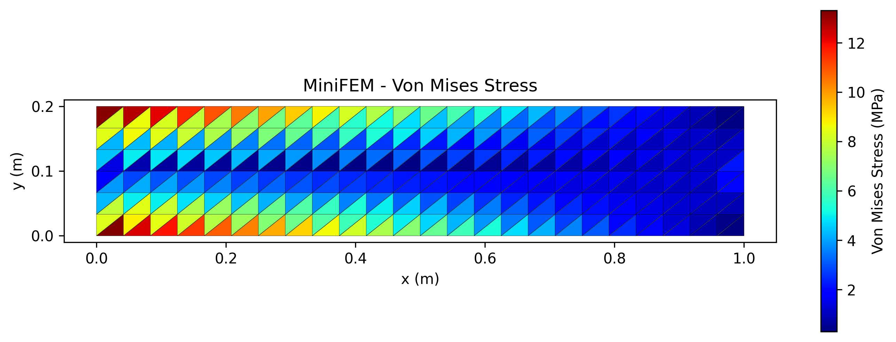
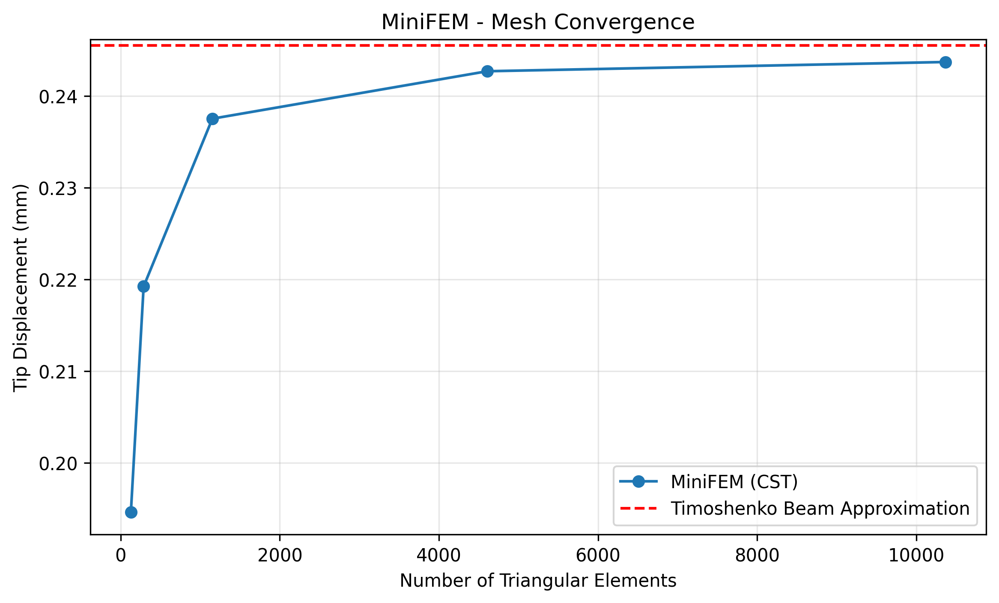

# MiniFEM-2D: Python Finite Element Solver

**A Python-based 2D Finite Element Solver for Linear Elasticity**

MiniFEM-2D is an educational finite element solver implemented in Python using NumPy and SciPy. It demonstrates the core numerical algorithms of the Finite Element Method (FEM), including element stiffness calculation, global sparse matrix assembly, boundary condition enforcement, displacement calculation, stress recovery, and numerical verification.

The project focuses on the mathematical and computational foundations of Computer-Aided Engineering (CAE) solvers.

## Key Features

- **Mesh Generation:** Structured 2D triangular meshes
- **Finite Element Formulation:** Three-node Constant Strain Triangle (CST) elements
- **Material Model:** Isotropic linear elasticity under plane stress
- **Matrix Assembly:** Global sparse stiffness matrix construction
- **Linear Solver:** Sparse direct solution using SciPy
- **Boundary Conditions:** Fixed displacement constraints and external loading
- **Post-processing:** Deformed mesh visualization and Von Mises stress contours
- **Numerical Verification:** Force equilibrium, linear system residual checks, and mesh convergence analysis

## Mathematical Formulation

The governing equation for static equilibrium is:

$$
\nabla \cdot \boldsymbol{\sigma}+\mathbf{f}=0
$$

The finite element system is expressed as:

$$
\mathbf{K}\mathbf{u}=\mathbf{F}
$$

For a three-node CST element, the stiffness matrix is computed using:

$$
\mathbf{K}_e=tA\mathbf{B}^{T}\mathbf{D}\mathbf{B}
$$

where:

- $t$: Element thickness
- $A$: Triangle area
- $\mathbf{B}$: Strain-displacement matrix
- $\mathbf{D}$: Elastic constitutive matrix
- $\mathbf{K}_e$: Element stiffness matrix

The solver explicitly constructs the element stiffness matrices and assembles the global sparse system.

## Numerical Example: Cantilever Beam

A two-dimensional cantilever beam is analyzed under static loading.

### Model Parameters

| Parameter | Value |
|---|---|
| Length | 1.0 m |
| Height | 0.2 m |
| Thickness | 0.01 m |
| Young's modulus | 210 GPa |
| Poisson's ratio | 0.30 |
| Applied vertical load | 1000 N |
| Element type | CST triangular element |
| Material behavior | Linear elastic |
| Analysis type | Plane stress |

### 1. Von Mises Stress Distribution

The following figure shows the computed Von Mises stress distribution for a cantilever beam subjected to a concentrated downward nodal force.

The stress field is recovered from the element displacement vector:

$$
\boldsymbol{\varepsilon}=\mathbf{B}\mathbf{u}_e
$$

$$
\boldsymbol{\sigma}=\mathbf{D}\boldsymbol{\varepsilon}
$$

For plane stress, the Von Mises equivalent stress is calculated as:

$$
\sigma_{vm}=\sqrt{\sigma_x^2-\sigma_x\sigma_y+\sigma_y^2+3\tau_{xy}^2}
$$

### 2. Point-Load Simulation Results

For the initial mesh containing 288 triangular elements:

| Quantity | Computed Result |
|---|---:|
| Tip vertical displacement | −0.219477 mm |
| Maximum element Von Mises stress | 13.31 MPa |
| Vertical support reaction | 1000 N |
| Relative linear system residual | 1.521 × 10⁻¹² |

The equilibrium verification confirms that the total vertical support reaction balances the externally applied load.

The small linear system residual demonstrates accurate numerical solution of the discretized equilibrium equations.

The reported maximum stress corresponds to the initial finite element mesh and should not be interpreted as a mesh-converged peak stress.

### 3. Mesh Convergence Study

To assess the numerical behavior of the finite element solver, a mesh refinement study is performed.

For this separate load case, a total downward force of 1000 N is uniformly distributed along the right boundary.

The triangular mesh is progressively refined while maintaining the same physical model and material properties.

### Convergence Results

| Triangular Elements | Vertical Displacement (mm) |
|---:|---:|
| 128 | 0.194643 |
| 288 | 0.219226 |
| 1,152 | 0.237519 |
| 4,608 | 0.242693 |
| 10,368 | 0.243699 |

The calculated displacement increases and gradually stabilizes as the mesh is refined.

For comparison:

- **Euler–Bernoulli beam approximation:** 0.238095 mm
- **Timoshenko beam approximation:** 0.245524 mm
- **Finest-mesh MiniFEM result:** 0.243699 mm

The finest-mesh result differs from the Timoshenko beam approximation by approximately **0.74%**.

This comparison provides a useful consistency check, but the beam theory result is not an exact solution of the two-dimensional elasticity problem.

The observed convergence behavior illustrates the importance of mesh refinement when assessing numerical accuracy.

## Technologies

- Python
- NumPy
- SciPy
- Matplotlib
- Google Colab
- Jupyter Notebook

## How to Run

1. Download `MiniFEM_2D_Elasticity.ipynb` from this repository.
2. Open the notebook using Google Colab or a local Jupyter environment.
3. Ensure that NumPy, SciPy, and Matplotlib are available.
4. Execute the notebook cells sequentially.
5. Inspect the generated finite element mesh, displacement results, stress distributions, and mesh convergence analysis.

## Current Limitations

MiniFEM-2D is an educational research and learning prototype, not a production-grade commercial CAE solver.

The current implementation supports:

- Small-deformation linear elasticity
- Isotropic elastic materials
- Two-dimensional plane stress analysis
- Three-node triangular elements
- Static structural analysis

The following capabilities are not yet implemented:

- Material nonlinearity
- Geometric nonlinearity
- Contact mechanics
- Advanced finite element formulations
- Parallel numerical computation

Further validation against established benchmark solutions and commercial finite element software would strengthen the solver's reliability.

## Future Development

Potential extensions include:

- J2 elastoplastic constitutive models
- Newton–Raphson nonlinear solution algorithms
- Additional finite element formulations
- Sparse solver performance benchmarking
- Comparison with Abaqus and Ansys results

## Project Files

**Source Code:**

[MiniFEM_2D_Elasticity.ipynb](MiniFEM_2D_Elasticity.ipynb)

**Simulation Results:**

- [Von Mises Stress Contour](von_mises_stress.png)
- [Mesh Convergence Analysis](mesh_convergence.png)

---

**MiniFEM-2D — Exploring the numerical foundations of finite element solvers and computational mechanics.**
